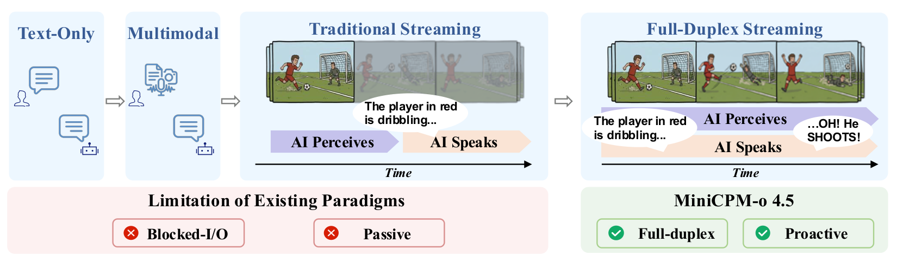
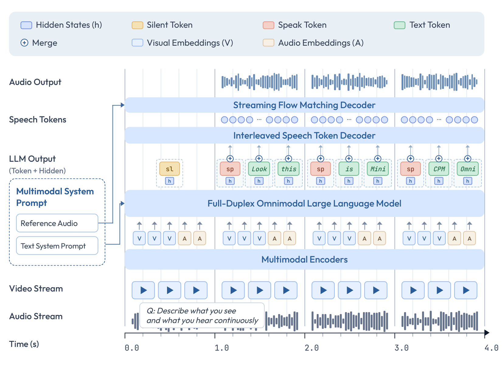
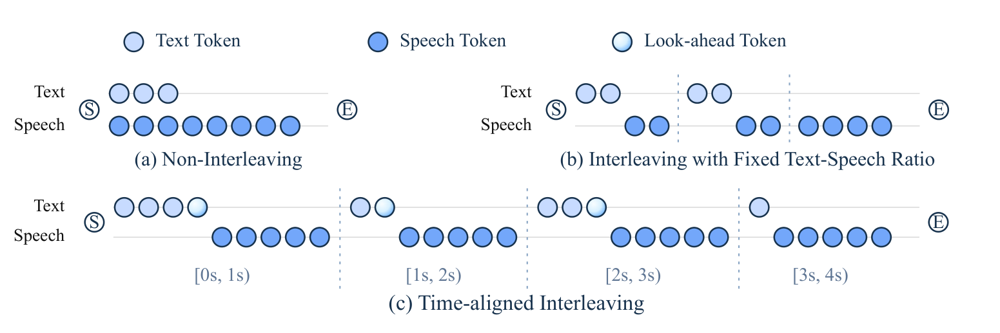

# MiniCPM-o 4.5：模型怎样一边听一边说

## 摘要翻译

近年来，多模态大语言模型的发展推动 AI 能力从静态、离线的数据处理走向实时流式交互，但它们距离人类水平的多模态交互仍然很远。当前的关键瓶颈不再只是模态覆盖范围或延迟，而是交互范式本身。首先，感知与响应仍被分隔为交替进行的阶段，使模型在生成过程中无法纳入新输入并及时调整。其次，当前多数模型仍然是被动响应式的，只对明确的用户请求作出回应，而不会在持续变化的多模态环境中主动行动。

我们提出 MiniCPM-o 4.5，这是我们向类人多模态交互迈出的最新一步；它通过实时全双工全模态交互来缓解上述差距。模型能够实时地同时看、听和说，也能基于对现场场景的持续理解，主动发出提醒或评论。MiniCPM-o 4.5 的关键技术是 Omni-Flow：一个沿共享时间轴对齐全模态输入与输出的统一流式框架。该形式化方法将传统的轮次式交互转换为全双工、时间对齐的过程，使感知与响应能够同时进行，并让主动行为在同一框架中产生。

MiniCPM-o 4.5 总参数量为 9B，其视觉语言能力接近 Gemini 2.5 Flash，在同等规模的开源模型中取得了领先表现。它在全模态理解上也超过 Qwen3-Omni-30B-A3B，并提供更好的语音生成质量，同时具有显著更高的计算效率。得益于高效的架构设计和推理优化，该模型能够以低于 12 GB 的内存开销，在边缘设备上进行实时全双工全模态交互。更重要的是，MiniCPM-o 4.5 可以被视为一个有前景趋势的代表性实例：多模态基础模型正在走向更接近人类的交互范式，并准备在不久的将来与动态的全模态世界进行交互。

摘要来源：MiniCPM-o 4.5，arXiv v1。译文保留作者在摘要中的能力与比较声明；这些措辞不代表本次精读已独立验证其全部适用范围。

## 问题空间

### 从流式生成到交互闭环

先想一个最简单的场景：助手正在根据镜头描述桌上的物品，用户突然说“不是红色那个，是旁边蓝色的”。如果系统只能等自己说完再处理这句话，那么它即使逐字播报、首字延迟很低，也仍然不是本文所说的 full-duplex。真正的问题是：**助手开口以后，新到的画面和声音能不能继续进入下一步决策，并让它停下、改口或保持沉默。**

论文因此把重点从“能接收哪些模态、多久开始回答”推进到“感知和输出能否持续互相影响”。作者认为现有系统主要卡在两处：听和说仍被排成相邻阶段；模型通常只在收到明确请求后回应，不会根据持续变化的环境主动开口。



这里有四个容易混在一起的概念：

- **流式输入**表示音频或视频未结束时就分块编码；
- **流式输出**表示完整回复尚未生成完就开始交付文字或音频；
- **实时**表示计算吞吐能够跟上现实时间，语音系统常用 $\mathrm{RTF}=\text{处理耗时}/\text{音频时长}$ 衡量；
- **交互式 full-duplex**要求助手输出期间的新输入继续进入决策，并能改变它接下来是继续说、停止、修正还是沉默。

前三项同时成立，系统仍可能是轮次式的。最直接的检验方法仍是刚才那个场景：助手已经开口后改变画面或插入一句话，后续输出有没有及时使用新信息。

VAD（Voice Activity Detection）只判断当前有没有人声，ASR（Automatic Speech Recognition）把语音波形转成文字。传统语音助手常采用 `VAD → ASR → 文本 LLM → TTS`：外部状态机先判断用户是否说完，再启动识别、回答和播音。MiniCPM-o 4.5 没有让回声消除、取消播放等工程问题凭空消失；它做的是把一部分“现在该听还是该说”的决定放进模型自己生成的序列里。

### 相关路线与本文位置

[[qwen2-5-omni|Qwen2.5-Omni]] 的 Thinker–Talker 已能分块编码音视频，并让文字与语音流式输出，但流式输入和流式输出并不自动形成持续的交互协议。Moshi 更早直接建模用户与助手两条并行语音流，可表达重叠说话、插话和附和；它主要处理语音—语音交互，没有视觉环境流。Freeze-Omni 也已使用按块状态预测处理打断。

因此，“首个全双工全模态大模型”只能作为作者的优先权声明保留。更稳妥的贡献是：论文给连续视觉、环境音频、文字和语音输出规定了一套共同的时间组织方式，再用显式 control token 表示听或说，并把整条链压到端侧可以运行的规模。

### 要用什么证据检验它

要证明这个系统真的能一边听一边说，至少要分别回答五件事：它有没有读到最新音视频；什么时候选择开口；环境改变后内容会不会更新；已经排队的旧语音能不能及时停下；计算速度能不能跟上现实时间。普通视觉问答、ASR、TTS 或单轮音视频 benchmark 各自只能覆盖其中一部分，把这些分数加在一起也不能自动推出 full-duplex 已经成立。

## 观察与核心 idea

### 三条共享时间轴上的流

Omni-Flow 的做法并不复杂：它把连续交互写成三条按时间前进的 stream，即环境视觉 `env-visual`、环境音频 `env-audio` 和助手输出 `out-stream`。用户请求只是环境音频中发生的一件事，不再是一个必须先完整结束的特殊 turn。每过一个 `chunk`，模型都会收到这一小段的新画面和新声音，然后决定这次保持 `[listen]`，还是生成 `[speak]` 和后续内容。

如果一个 `chunk` 覆盖 $t$ 秒，第 $k$ 个 `chunk` 中的视觉、音频和输出 token 分别记作 $\mathbf v_k$、$\mathbf a_k$、$\mathbf o_k$，论文把它们接成

$$
\mathbf g_k=[\mathbf v_k;\mathbf a_k;\mathbf o_k],
\qquad
\mathbf G=[\mathbf g_1;\mathbf g_2;\ldots;\mathbf g_K].
$$

在每个 `chunk` 里，模型先看到新到的感知 token，再生成输出 token；不该说话时，$\mathbf o_k$ 只有 `[listen]`。因此模型不需要真的在同一个计算瞬间同时运行三条网络，它只要反复执行“读入这一秒的新信息，再决定这一秒说什么”即可。

```text
chunk k：   新视觉 + 新环境音频 → listen / speak → 当前输出
chunk k+1：新视觉 + 新环境音频 → listen / speak → 根据新信息更新输出
```

这是一种离散近似：`chunk` 越短，新环境越快进入决策，但模型也会更频繁地处理边界，单个 `chunk` 中可用的上下文更少。论文最终选择约 1 秒的 `chunk`，追求的是一秒级更新下的工程平衡；它没有做到 Moshi 那种几十毫秒粒度的话轮协调。

### 主动性来自协议与数据，不会由架构自动产生

Omni-Flow 允许没有显式请求时仍预测 `[speak]`，所以主动提醒可以与普通响应使用同一格式。协议只解决“主动行为怎样被表示”；哪些事件值得提醒、何时应沉默，仍由正负样本、时间标注、风险权重和部署策略决定。论文没有系统评估错误抢话、漏提醒或长期打扰率，因此“主动行为自然产生”只能理解为它可以在同一序列目标中学习。

## 方法

### Problem setting 与完整信息流

每个 `chunk` 到来时，模型拿到最新的视觉、环境音频、此前输出和系统提示。它先决定 `[listen]` 还是 `[speak]`；选择说话后，再生成数量不固定的 text token。随后一个轻量 speech-token decoder 读取这些 text token 和语言模型的 hidden state，生成离散 speech token；流式 flow-matching decoder 最后把它们还原成可以播放的波形。

```text
视频帧 → SigLIP ViT → Visual Resampler ┐
                                      │
麦克风 → Whisper encoder → Projector ├→ Qwen3-8B → Listen/Speak + 文本 + hidden state
                                      │                              ↓
系统提示与历史输出 ───────────────────┘                    轻量 speech-token decoder
                                                                    ↓
                                                           流式波形 decoder
```



### 视觉、音频与语音侧的速率分工

持续视频最先遇到的问题是 token 太多。每个图像切片原本会产生 1024 个 SigLIP patch token，Visual Resampler 用 64 个可学习 query 通过 cross-attention 去读取它们，最终只输出 64 个 token。它不是简单抽取 64 个 patch，也不是平均池化；这些 query 会学着从整张特征图中取出后续任务需要的信息。full-duplex 模式还把最大分辨率限制为 $448\times448$，普通模式则可到 $2240\times2240$。这里的取舍很直接：少保留一些空间细节，换来持续视频所需的上下文和计算预算。

音频侧用 Whisper Medium encoder 分块编码，每秒先产生 50 个 feature token，再由两层 MLP 压到每秒 10 个 audio token。这里借用的是 Whisper 的声学表示，系统没有先等 ASR 产出一份定稿文字；原始声学信息可以直接影响模型是听、说，或者接下来生成什么。

如果让 8B LLM 直接以 25 Hz 生成语音，计算会很贵。论文让 Qwen3-8B 只在文本侧以约每秒 3–4 步工作，再把它的 hidden state 从 $4096$ 维投影到 $768$ 维，与 text embedding 一起交给约 0.3B 的 Llama speech-token decoder。于是大模型负责变化较慢的语义和控制，小模型负责以 25 Hz 生成 S3 speech token，最后再转成波形。

### Listen–Speak 控制与边界

模型每个 `chunk` 都要面对一个问题：现在不说话，还是开始生成内容？Listen–Speak（LS）先单独预测这个二元选择，再在 `[speak]` 之后生成文字；Listen–Text（LT）则让 `[listen]` 直接和普通 text token 在同一个输出空间里竞争。LS 可以写成下面的分层形式：

$$
p(c_k,y_k\mid h_k)
=p(c_k\mid h_k)\,p(y_k\mid c_k,h_k),
$$

其中 $c_k\in\{\text{listen},\text{speak}\}$，$h_k$ 是当前多模态历史。论文的 Table 1 支持 LS 在已测试配置中更稳定，但该表没有覆盖所有正交组合，不能精确分离控制形式、边界和 `chunk` 长度各自的净贡献。

### TAIL：每个 `chunk` 该生成多少文字

TAIL 要解决的不是“能不能流式播音”，而是一个更具体的问题：**每过一秒，LLM 应该提前生成多少 text token？**

一种做法是先生成很长一段文字，再让 TTS 慢慢播放。这样一旦画面变化或用户插话，播放器里还排着很多旧内容。另一种做法是固定按 $N$ 个 text token 搭配一段 speech token。问题是，token 数不等于发音时长：“AI”与一个长英文单词可能都是少量 token，标点、语速和停顿也会改变实际时长。固定比例跑得越久，模型内部的文字进度与真实说话进度越容易错开。



Time-Aligned Interleaving（TAIL）保留约一秒一个 `chunk` 的节奏，但每个 `chunk` 允许包含不同数量的 text token。说得快的一秒可以放得多，长词或停顿较多的一秒就放得少。论文没有另外训练一个 duration head；所谓“自适应”来自训练数据怎样放置 `boundary token`，以及模型在推理时何时把这个 token 生成出来。

具体来说，每个 text token $y_i$ 都有发音开始时间 $s_i$。当 `chunk` 宽度为 $t$ 时，第 $k$ 个 `chunk` 收下所有开始时间落在该区间的 token：

$$
T_k=\{y_i\mid s_i\in[(k-1)t,kt)\}.
$$

对应的 speech token 也按时间分到这个 `chunk`。因为一秒内实际能说出的文字量会变化，$|T_k|$ 自然不是常数。数据构造器在这组文字末尾插入 `chunk_eos`，LLM 仍然使用普通 next-token loss：

$$
\mathcal L_{\mathrm{LLM}}
=-\sum_m\log p(Z_{k,m}\mid Z_{<k},Z_{k,<m},X_{\le k}),
$$

其中 $Z_k=(\texttt{speak},y_1,\ldots,y_{n_k},\texttt{chunk\_eos})$。到了推理时，模型事先不知道当前 `chunk` 应该有几个 text token。它逐 token 生成，每一步都让 `<|chunk_eos|>` 与普通词竞争；第一次生成 `<|chunk_eos|>`，当前 `chunk` 就结束：

$$
n_k=\text{第 }k\text{ 个 chunk 首次生成 boundary 前的普通 text token 数}.
$$

所以，本次讨论得到的理解是对的：**在线阶段的动态长度，核心就是自回归预测 `boundary token`。** 其余设计没有再提供一个神秘的自适应控制器；它们负责让这个简单机制能够工作，包括时间戳生成的变长标签、跨 `chunk` 历史、近固定的 speech-token 预算和少量未来文字。

### TAIL 的训练与推理

训练与推理可以一一对应：

| 训练时 | 推理时 |
| --- | --- |
| 时间戳决定第 $k$ 个 `chunk` 含 $n_k$ 个 text token | 模型不知道 $n_k$，逐 token 生成 |
| 在第 $n_k+1$ 个位置放 chunk boundary | 每步让 boundary 与普通文字竞争 |
| teacher forcing 提供正确历史 | 使用自己的边界历史与 KV cache |
| 对应 speech token 作为该 `chunk` 的语音目标 | speech decoder 生成约一秒的 speech token |

论文没有单独定义一个 `TAIL loss`。`boundary token` 和普通 token 一样接受 next-token cross-entropy；speech decoder 则根据 text embedding、LLM hidden state 和历史 speech token 预测下一个 S3 token。TAIL 主要在 joint pretraining 的时间对齐 full-duplex 数据中学到，joint SFT 再细化交互。后面的 GRPO 与 RLAIF-V 没有使用“待播放语音长度”或 boundary 准确率作为 reward，因此不能说 TAIL 的动态长度是 RL 学出来的。

TAIL 还允许把 `chunk` 末尾少量文字对应的语音推迟到下一个 `chunk`，让 speech decoder 多看到一点未来文字，从而改善依赖后词的发音和韵律。论文没有说明究竟延后几个 text token。官方推理代码里另有 3 个 S3 token、约 120 ms 的声学 look-ahead，但它服务于波形分块的连续性，不能拿来填补论文没有披露的 TAIL 文本 look-ahead。

公开推理实现进一步显示：duplex unit 默认约 1 秒，普通 `chunk` 大约生成 25 个 25 Hz S3 token；LLM 一侧最多允许生成 20 个 speak-side token，如果一直没有生成 boundary，就会被强制截断。这个上限只是防止模型失控的 guardrail，不是 TAIL 自适应长度的来源。

### 四阶段训练

1. **Speech pretraining。** 冻结预训练视觉和语言组件，只训练新加入的 audio projector、LLM-to-speech projector 与 speech decoder，先接通声学表征和 hidden-state-to-speech-token 路径。
2. **Joint pretraining。** 解冻全部参数，平衡混合视觉语言、语音和 omni-modal 数据；带共同时间索引的主动/全双工样本用统一 next-token objective 训练。这是 TAIL 边界监督最明确进入模型的阶段。
3. **Joint SFT。** 先用大规模指令数据扩展覆盖，再以高质量人工数据细化行为；视频分辨率在 0.2–0.4 MP、采样率在 1–5 FPS 间随机变化。
4. **RL。** 用 GRPO 优化推理和指令遵循，再用 RLAIF-V 缓解视觉幻觉。平滑长度奖励针对整段回复效率，不是 TAIL 的窗内动态长度训练。

full-duplex 样本包含完整视觉、环境音频、输出文字与输出语音，并给各部分时间索引。网页音视频用于扩大覆盖，人工任务数据覆盖持续场景描述和主动提醒。论文没有公开 full-duplex 子集规模、Listen/Speak 分布、时间戳取得方式、序列化器、loss mask、边界权重或文本前瞻长度，因此可以复现推理协议骨架，不能忠实复现训练 recipe。

## 实验与论证

### 一秒显式分组与 Listen–Speak 是否合理

Table 1 的关键结果如下：

| Chunk | Boundary | Control | AdvBench | AlpacaEval | IFEval | SDQA | MMLU |
| --- | --- | --- | ---: | ---: | ---: | ---: | ---: | ---: |
| 1.0 s | Explicit | LS | **0.98** | 3.56 | **0.29** | **0.36** | **0.65** |
| 1.0 s | Explicit | LT | 0.92 | **3.60** | 0.24 | 0.35 | 0.56 |
| 1.0 s | Implicit | LT | 0.96 | 3.31 | 0.22 | 0.28 | 0.45 |
| 0.2 s | Explicit | LS | 0.81 | 1.22 | 0.10 | 0.09 | 0.45 |
| 0.1 s | Explicit | LS | 0.67 | 2.40 | 0.10 | 0.13 | 0.32 |

这张表回答的是“怎样切 `chunk`、怎样表示听或说，哪组配置更稳”。把 `chunk` 从 1 秒缩到 0.2 或 0.1 秒后，多项指标明显下降；在同为 1 秒的设置里，显式边界优于隐式边界，LS 除 AlpacaEval 外也优于 LT。因此作者选择了 `1.0 s + Explicit + LS`。不过表中缺少 `Implicit + LS` 等组合，无法把收益精确归因到单一因素；这里的 group boundary 也不是专门检验 TAIL 的动态文本边界。

### Full-duplex 主结果实际测到了什么

Tables 2–7 主要在回答“统一训练以后，原有的视觉、音频、文字和单轮音视频能力有没有明显损坏”。结果说明底座仍有竞争力，Table 7 甚至明确属于 simplex setting；它们没有直接测试模型能否一边听一边说。

Table 8 是论文唯一量化的 full-duplex benchmark：MiniCPM-o 4.5 在 LiveSports-3K-CC 的 win rate 为 54.4，高于 StreamingVLM 的 45.6 和 LiveCC 的 41.5。但这个 benchmark 没有音频。它说明模型能随着持续画面生成更合适的描述，却没有测试助手说话时能否听见用户、处理插话，或让视觉、输入语音和输出语音长期保持同步。

### TAIL 是否真的改善了时间同步

Table 10 只报告可懂度和说话人相似度：

| Interleaving mode | 中文 CER↓ | 中文 SIM-o↑ | 英文 WER↓ | 英文 SIM-o↑ |
| --- | ---: | ---: | ---: | ---: |
| No interleave | 1.44 | 74.1 | 2.70 | 64.9 |
| Fixed text | **0.86** | **74.5** | **2.38** | 64.9 |
| Dynamic text（TAIL） | 1.04 | 74.1 | 3.93 | **65.1** |

Table 10 能说明两件事：TAIL 生成的语音仍然可懂，但英文 WER 从 fixed text 的 2.38 上升到 3.93，动态边界和有限 look-ahead 可能损害语音稳定性。它没有回答更关键的问题：已经生成但还没播出的音频会不会越积越多？环境变化后，旧内容还会播多久？遇到额外延迟以后，系统能不能把队列重新降下来？因此，这张表验证了语音质量，没有直接验证 TAIL 宣称要改善的长期时间同步。

### 运行时是否跟得上现实时间

Table 12 提供了较强的系统证据：

| Framework | 精度 | RTX 4090 RTF | RTX 内存 | DGX Spark RTF | DGX 内存 |
| --- | --- | ---: | ---: | ---: | ---: |
| PyTorch | BF16 | OOM | OOM | 2.43 | 26 GB |
| PyTorch | INT4 | 1.26 | 14 GB | 1.27 | 14 GB |
| llama.cpp-omni | FP16 | 0.27 | 19 GB | 0.46 | 19 GB |
| llama.cpp-omni | INT4 | **0.21** | **11 GB** | **0.20** | **11 GB** |

llama.cpp-omni 的 RTF 小于 1，说明报告实现平均每处理一秒音频用时不到一秒，这是系统持续运行的必要条件。PyTorch INT4 的 RTF 大于 1，也说明模型接口支持 streaming，并不等于实际实现一定 real-time。要让 full-duplex 长时间工作，还需要同时满足

$$
\mathrm{RTF}<1
\quad\land\quad
\text{待播放的语音不会随着时间不断增加}.
$$

论文量化了左侧，没有量化右侧。

## 贡献与边界

### 可信贡献

Omni-Flow 最值得复用的地方，是它把“边看边听边说”改写成标准因果模型可以学习的序列：每个 `chunk` 先加入新的视觉和音频，再生成 `[listen]` 或 `[speak]`。这样，“保持沉默”也成了模型可以学习的动作，持续感知、主动开口和传统 turn-based 对话便能使用同一套接口。

证据最扎实的工程贡献是完整可部署链：视觉与音频压缩、8B 语言骨干、约 0.3B 语音 decoder、流式波形解码和优化运行时在 11 GB INT4 内存下实现约 0.20–0.21 RTF。它证明 9B 级端到端全模态系统有机会在边缘硬件上持续运行。

TAIL 是一个结构很简单、但证据还不够完整的子贡献。它用发音时间戳决定训练序列中的 `boundary token`，再让模型自回归决定每个 `chunk` 生成几个 text token。论文测了这样做对语音质量的影响，却没有直接测量待播放音频是否真的更少。

### 最脆弱的假设

最脆弱的假设是：模型看不到真实播放器，却仍能只靠离线时间戳、自己的生成历史和 KV cache 长期保持同步。公开材料里没有显式 `delay_seconds`、真实 playhead 或 queue length。假如网络、设备调度或声码器让播放慢了半秒，模型内部仍可能认为前一个 `chunk` 已经正常完成。此时 TAIL 学到的更像训练数据里的平均节奏，它没有可靠信号知道真实播放器已经落后，也就很难主动把 backlog 降回来。

teacher forcing 还带来第二个风险：训练时模型总能看到正确的历史 boundary；推理时如果一次过早或过晚生成 boundary，这个错误会进入下一个 `chunk` 的历史。论文没有报告这类误差会自行消失，还是会在长对话中继续累积。

### 作者承认与本文补充的局限

作者明确承认长时间动态场景鲁棒性尚未验证，流式语音存在误读和无意代码切换，网络不稳定会使 demo 延迟或丢片段，主动行为仍较简单。除此之外，正文没有系统处理扬声器回声、多人说话归属、已排队波形取消、重叠语音或长期缓存增长。固定一秒窗也难以表达几十到几百毫秒级的附和、抢话和紧急中断。

因此，本文证明了“统一协议与系统能够运行”，部分支持“一秒显式 LS 是合理配置”，尚未证明“真实环境中的通用类人全双工已经解决”。

## 研究响应

### Takeaways

- **问题**：多模态模型怎样在说话期间继续看和听，并根据新环境决定沉默、继续、停止、修正或主动提醒？
- **核心 idea**：每个 `chunk` 先写入新的视觉和环境音频，再决定 `[listen]` 或 `[speak]`；TAIL 用发音时间戳制作长短不同的训练标签，推理时由 `boundary token` 决定当前 `chunk` 生成几个 text token。
- **可信结论**：9B 模型形成完整感知—文字—语音 token—波形链；报告运行时在 11 GB INT4 内存下达到约 0.20–0.21 RTF；一秒显式 LS 在论文消融中整体更稳。
- **仍未证明**：TAIL 能让真实播放队列长期保持稳定，系统能可靠处理插话与重叠说话，主动提醒不会频繁抢话，以及三条 stream 在长时间运行后仍然同步。
- **可复用启发**：token 时钟、语音播放时钟和外部墙钟必须分开测量；RTF 小于 1 只解决计算积压，不能保证内容不过期。

### 一周最小复现

只验证一个窄 claim：在相同权重、speech decoder 和运行时下，TAIL 是否比平均长度相同的 Fixed-N 更能避免待播放语音越积越多。

准备 60 条、每条 60–120 秒的连续场景脚本，包含画面变化、用户插话、中英文、快慢语速、长词、停顿和代码切换。TAIL 使用官方动态 boundary；Fixed-N 固定每个 `chunk` 的 text-token 数，$N$ 取 TAIL 在开发集上的平均值。记录环境 `chunk` 到达、text token 与 boundary 生成、speech token、波形入队和真实播放起止时间。

定义播放积压

$$
B(t)=\text{时刻 }t\text{ 已生成但尚未播放的语音时长},
$$

另一个指标直接记录：环境改变以后，最后一段依据旧环境生成的音频还会继续播放多久。报告 $B(t)$ 的均值、P95 和随时间变化的斜率，以及打断停止延迟、恢复到 $B<0.5$ 秒需要几个 `chunk`、guardrail 触发率、CER/WER、SIM-o 与 RTF。在 20% 的 `chunk` 中额外注入 300 或 600 ms 计算/播放延迟。

预注册判据可以设为：TAIL 相比 Fixed-N 将 P95 backlog 和“旧内容继续播放的时间”至少降低 30%，CER/WER 相对恶化不超过 50%，且 RTF 仍小于 1。若 backlog 长期持续上升，或注入抖动后始终降不回来，就应收窄论文关于长期对齐的解释。

### 反例设计

连续运行十分钟，随机让真实播放器变慢，但不改模型的 KV cache；在 backlog 最大时再改变画面目标或插入用户语音。如果模型仍按训练中的平均节奏生成 boundary，旧内容也没有更快停下，就说明它内部记录的生成历史不能代表播放器的真实进度。这个结果会反驳“TAIL 能根据实际播放情况自行纠偏”的强解释，但仍允许一个较弱结论：TAIL 学到了离线训练数据里的平均时间节奏。

### 后续研究与新认知

检索截止 2026-10-13。Moshi 表明两条语音 codec 流可以在约 80 ms 粒度表达重叠说话，并显式用 100–500 ms 回声增强覆盖物理声学回路。Qwen2.5/3-Omni 主要优化请求后的 Thinker–Talker 流式语音生成；MiniCPM-o 4.5 的增量是在连续 `chunk` 中反复决定听还是说。

后于本文的 DuplexOmni 把不能阻塞的实时 interaction layer 与较慢的推理/工具层异步分离。AdaptDuplex 又把下一个 `chunk` 的长度、Listen/Speak、memory 与异步请求控制显式 token 化，并让 `chunk` 可取 0.48、0.64 或 0.96 秒。其 v3 在 HumDial-FDBench 报告 MiniCPM-o 4.5 的 interruption 72.4、delay 2.203 s、final 60.6，而 AdaptDuplex 为 82.2、1.042 s、69.6。模型、数据和硬件同时不同，所以这不是动态 `chunk` 的单因素消融；它仍说明本文缺少的交互时机指标后来已经可以被直接评测。

### Follow-up idea：Playback-Aware TAIL

一个直接扩展是把真实播放器还积压了多少音频反馈给模型，例如量化为 `queue_empty`、`queue_0_250ms`、`queue_250_500ms`、`queue_500_1000ms` 与 `queue_over_1000ms`。队列近似满足

$$
B_{k+1}=\max(0,B_k+d(y_k)-t-r_k),
$$

其中 $d(y_k)$ 是当前文字实际合成的语音时长，$t$ 是一个 `chunk` 内播放器正常前进的时间，$r_k$ 表示取消、丢包或设备抖动。训练时注入播放器延迟和取消事件，并惩罚 backlog 超过阈值的持续时间。这样模型不再只模仿离线时间戳，而是能看到播放器究竟走到了哪里。

最小证伪实验就是上一节的延迟注入：若真实 queue state 仍不能改善恢复时间，瓶颈更可能在语音时长预测、声码器或取消机制，而非状态不可观测性。该方案是基于论文缺口提出的分析设想，不是原文方法，也未完成全面新颖性检索。

## 与 Wiki 的连接

- [[qwen2-5-omni]] 提供强语言骨干与轻量语音生成器的前代职责分工；本文把单次流式回答推进为持续 Listen/Speak 决策。
- [[qwen3-8-omni]] 关注长音视频取证与工具循环；本文关注墙钟时间上的快速 interaction loop。未来系统需要快慢双环协作。
- [[omni-model-architecture-paths]] 因本文增加“持续交互协议”这条正交比较轴：统一 embedding、统一 token 或 Thinker–Talker 都不能自动推出全双工。
- [[full-duplex-timing-attribution]] 继续追踪模型协议、时间戳数据、播放器反馈和运行时取消各自对稳定性的贡献。

## 来源与证据边界

- 论文：MiniCPM-o 4.5，arXiv v1，2026-04-30：https://arxiv.org/abs/2604.27393
- 官方项目：https://github.com/OpenBMB/MiniCPM-V
- 官方模型与推理代码：https://huggingface.co/openbmb/MiniCPM-o-4_5
- 后续比较：Moshi、Qwen2.5-Omni、Qwen3-Omni、DuplexOmni 与 AdaptDuplex，链接见来源指针。

论文部分依据用户提供的 22 页 PDF 全文，并以 arXiv 页面核验版本。经用户明确允许，本页从该 PDF 截取 Figure 3、Figure 4 与 Figure 5 的图形主体；截图不包含论文 caption 或周围正文，并在插入处标明原始图号、用途和证据边界。Tables 1、10、12 继续只用 Markdown 重建改变判断的数字。

论文、代码与分析的证据身份保持分离：训练方法以 Sections 3–5 为准；特殊 token、默认 `chunk` 长度和 guardrail 来自官方公开推理实现；“TAIL 只学到训练数据里的平均时间节奏”“Playback-Aware TAIL”和最小复现实验属于分析推断。官方材料没有披露 TAIL 时间戳生成、训练 serializer、loss mask、边界权重、文本 look-ahead 长度和真实播放器反馈，不能据此声称训练已完整可复现。
